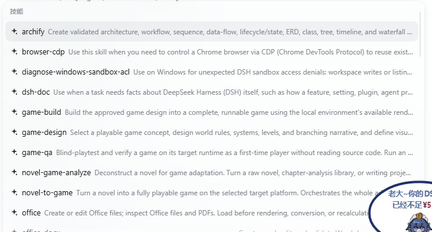
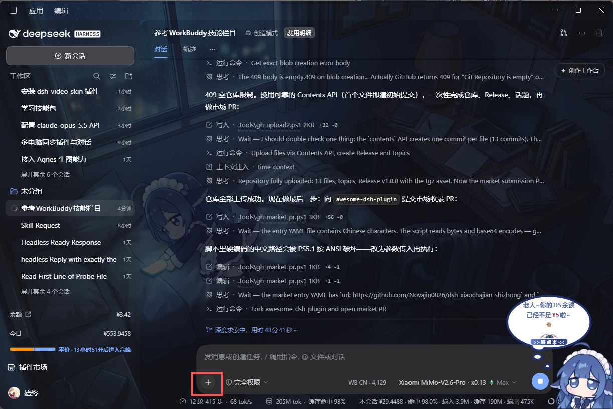
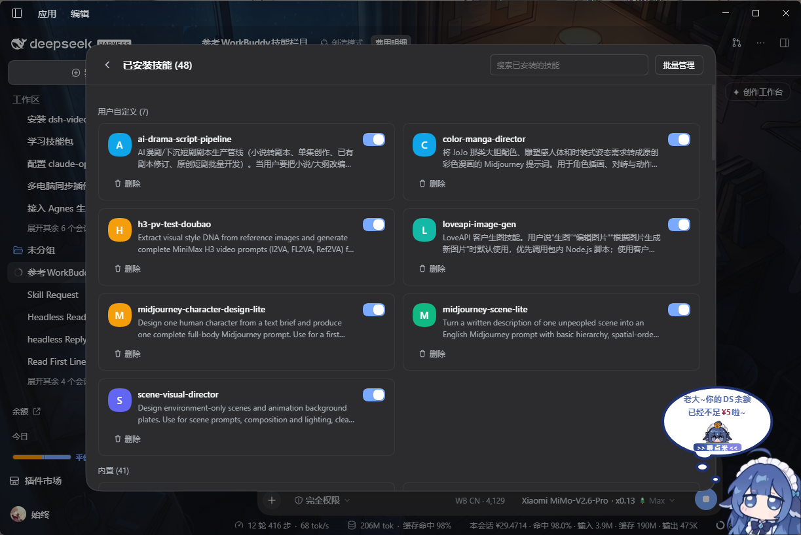

# Skill Management

**Skills section in the composer `+` menu, plus a skill manager — for [DeepSeek Harness](https://github.com/deepseek-ai/deepseek-harness).**

[中文](README.zh.md)



## What it does

- **Skills section in the `+` menu** — the composer's `+` menu gains a `Skills` group above the built-in rows. It lists the skills visible to the current session, and only the ones you have **enabled** in the manager. Choosing one inserts `/skill-name ` into the draft so you can add a request before sending; nothing is sent automatically.
- **Skill manager** — a panel opened from the *Manage skills* row at the bottom of the group:
  - search installed skills;
  - enable / disable each skill (disabled skills disappear from the `+` menu);
  - delete user-defined and workspace skills — the folder moves to `~/.dsh/skill-menu-trash/` so it can be recovered by hand (built-in skills can only be disabled);
  - batch enable / disable.
- **Import from local disk** — the *Add skill from local* row opens the system folder picker and copies the chosen skill folder (it needs a `SKILL.md`) into `~/.dsh/skills/`, then shows it in the manager.
- **No duplicates** — the typed `/` skill menu is untouched, so the skills list never appears twice. Subagent composers are excluded entirely: opening their `+` menu never queries the skill catalog.
- Enable/disable state is kept in browser localStorage and survives restarts.

## Install

DeepSeek Harness 0.2.2 or newer.

```sh
dsh plugin --profile desktop add github:Novajin0826/dsh-xiaochajian-shizhong
```

On a plain `dsh web` profile replace `desktop` with `web`, then restart. From inside the DSH Desktop app, use **Settings → Plugins** instead of the command line.

## Usage

**1. Reference a skill in chat (image 1)** — double-click the `+` button next to the composer to open the skill picker; choosing a skill inserts `/skill-name ` into the draft so you can finish your request before sending. Nothing is sent automatically.



**2. Skill manager (image 2)** — the manager panel lets you search installed skills, enable/disable each one, delete (files move to a recoverable trash folder), batch enable/disable, and import a skill folder from disk.



## What this plugin does

A **skill reference tool built into the chat**, similar to the WorkBuddy skill bar — quick and convenient:

- **Reference skills where you talk** — no page switching, no typing full names: double-click `+`, pick a skill, finish your sentence, send;
- **You decide what is on** — one toggle per skill in the manager; disabled skills disappear from the `+` picker immediately;
- **Tidy even with many skills** — search, groups (user-defined / workspace / built-in) and batch actions keep dozens of skills findable in seconds;
- **No duplicates, no leakage** — the typed `/` skill menu is untouched, and subagent composers are fully isolated.

## Notes

- Deleting keeps files recoverable in `~/.dsh/skill-menu-trash/`; they are never destroyed.
- The delete and folder-import endpoints live in the plugin's host half; if they report unavailable after upgrading the plugin, restart DSH once.
- Built-in skills shipped by the agent preset can be disabled but not deleted.

## License

MIT
