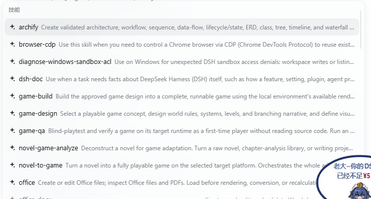

# Skill Management

**输入框 `+` 菜单里的技能分组 + 技能管理页 —— DeepSeek Harness 插件。**

[English](README.md)



## 功能

- **`+` 菜单技能分组** —— 输入框 `+` 菜单顶部增加“技能”分组，列出当前会话可见、且在管理页中**启用**的技能。点选技能后把 `/技能名 ` 插入草稿，可继续补充需求再发送，不会自动发送。
- **技能管理页** —— 从分组底部“管理技能”打开：
  - 搜索已安装技能；
  - 逐个启用 / 停用（停用后不出现在 `+` 菜单）；
  - 删除用户自定义与工作区技能 —— 文件夹移到 `~/.dsh/skill-menu-trash/`，可手动找回（内置技能仅可停用）；
  - 批量启用 / 停用。
- **本地导入** —— “从本地添加技能”弹出系统文件夹选择框，把选中的技能文件夹（内含 `SKILL.md`）复制到 `~/.dsh/skills/`，并在管理页中展示。
- **不重复** —— 打 `/` 的原生技能菜单不受影响，不会出现两份技能列表；子代理输入框完全隔离，打开它的 `+` 菜单不会查询技能目录。
- 启用/停用状态存在浏览器本地，重启后保留。

## 安装

需要 DeepSeek Harness 0.2.2 或更新版本。

```sh
dsh plugin --profile desktop add github:Novajin0826/dsh-xiaochajian-shizhong
```

普通 `dsh web` 环境把 `desktop` 换成 `web` 后重启。DSH Desktop 桌面端请在 **设置 → 插件** 里安装。

## 使用

1. 点击输入框的 `+` —— **技能**分组就在菜单最上方。
2. 点选技能或回车，把 `/技能名 ` 插入草稿。
3. 打开 **管理技能** 搜索、启用、停用、删除、批量管理已安装技能。
4. 打开 **从本地添加技能** 从磁盘导入技能文件夹。

## 说明

- 删除的文件保留在 `~/.dsh/skill-menu-trash/`，不会销毁。
- 删除与本地导入由插件宿主半提供；升级插件后如提示不可用，重启一次 DSH。
- Agent preset 自带的内置技能仅可停用、不可删除。

## 许可

MIT
